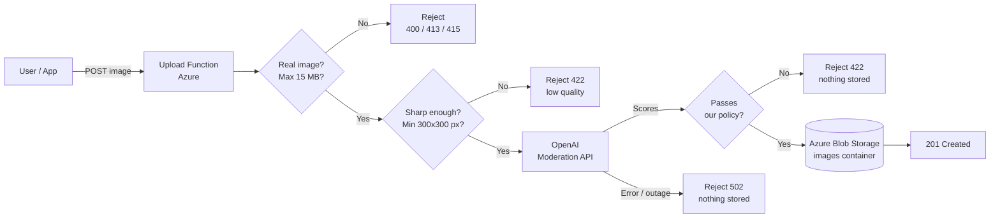

# Image Upload with Automatic Content Moderation (POC)

A proof of concept that lets users upload images and automatically rejects **low-quality** images (too small or blurry) and blocks **NSFW, violent or self-harm** images before they are stored. It runs on Azure Functions (Node.js) and Azure Blob Storage. Content is checked by the **OpenAI Moderation API**.

**Status:** Working POC, deployed to Azure (resource group `souvik-rg-96`). Last verified on 2026-11-26.

## Contents

- [1. Summary (for everyone)](#1-summary-for-everyone)
- [2. How the quality check works](#2-how-the-quality-check-works)
- [3. How OpenAI moderation works](#3-how-openai-moderation-works)
- [4. For the business team and product owner](#4-for-the-business-team-and-product-owner)
- [5. For the dev team](#5-for-the-dev-team)
- [6. Path to production](#6-path-to-production)
- [7. References](#7-references)

---

## 1. Summary (for everyone)

### The problem

Any feature that lets users upload images carries a risk: someone uploads explicit, violent or disturbing content. If we store and display it, we face brand damage, legal exposure, app store policy violations and a poor experience for other users. Reviewing every image by hand does not scale.

### What this POC does

Every uploaded image goes through two automatic checks **before** it is saved:

1. **Quality check:** is the image big enough and sharp (not blurry)?
2. **Content check:** OpenAI's moderation model checks it for harmful content.

- **Good-quality, safe image:** saved to storage, and the user gets a success response.
- **Too small or blurry image:** rejected with a clear reason, and **never saved**.
- **Unsafe image:** rejected with a clear reason, and **never saved**.
- **Moderation service unavailable:** the image is rejected and not saved. The system never stores an image it could not check. This is called "failing closed".

### At a glance



### Results on our test images (live Azure endpoint, 2026-11-26)

| Test image | Result |
|---|---|
| `sharp.jpg`: sharp, safe image (800×600) | **Stored**: sharpness 1503.7, all moderation scores below 0.001 |
| `blurry.jpg`: the same image, blurred | **Rejected**: too blurry (sharpness 7.3, minimum 100) |
| `low-res.jpg`: the same image, 240×180 px | **Rejected**: resolution too low (minimum 300×300) |
| `safe.png`: small flat graphic (200×200) | **Rejected**: resolution too low *and* too blurry |
| Photo of a man raising a knife at another man | **Blocked**: violence 0.834 |
| Gore image (blood-covered, mutilated face) | **Blocked**: violence 0.767, graphic violence 0.717 |
| Text file renamed `.png` | **Rejected**: not a real image (415) |

### Why OpenAI moderation

An earlier version of this POC used a different moderation service. In testing, it scored both violent images above as completely safe. OpenAI's moderation model blocked both. It was also the cheapest option we found: free. See [Cost](#cost).

---

## 2. How the quality check works

Every image must pass two rules before it is sent for moderation.

### Rule 1: Minimum resolution

Width and height must both be at least **300 pixels**. For comparison, a phone photo is typically 3000+ pixels wide, and a thumbnail is often under 200. Phone photos are measured upright, as displayed.

### Rule 2: Not blurry

Each image gets a **sharpness score**, using a standard technique called *variance of the Laplacian*:

1. The image is converted to greyscale and scaled so its longer side is at most 1024 px, so every image is judged at the same size.
2. An edge detector (the Laplacian) measures, for every pixel, how different it is from its neighbours.
3. A **sharp** image has crisp edges, so those differences vary a lot: **high score**. A **blurry** image has soft edges: **low score**.

An image scoring **below 100** is rejected as blurry.

### How the threshold of 100 was chosen

Scores for a real photo (1200×822) and blurred or degraded copies of it:

| Version of the photo | Sharpness | Result |
|---|---|---|
| Original | 416.7 | Pass |
| Heavily JPEG-compressed (quality 10) | 340.4 | Pass: compression isn't mistaken for blur |
| Slightly blurred (Gaussian σ=1) | 112.5 | Pass, just |
| Noticeably blurred (σ=1.5) | 41.7 | Reject |
| Strongly blurred (σ=2 / 3 / 5) | 20.1 / 7.8 / 4.0 | Reject |
| Shrunk to 400 px, then enlarged back | 58.3 | Reject |
| Shrunk to 200 px, then enlarged back | 10.2 | Reject |

### Known limitation

Images with very little detail **by design**, such as a plain background, a simple logo or a flat illustration, have few edges. They score low and may be rejected as blurry even though they are perfectly sharp. If such images are expected (e.g. logos), the threshold should be lowered, or the rule relaxed for them.

The minimum resolution and the blur threshold are app settings, so they can be changed without a code change.

---

## 3. How OpenAI moderation works

The OpenAI Moderation API (model `omni-moderation-latest`) is a free service from OpenAI that classifies text and images for harmful content. We send it an image, and it returns a **confidence score from 0 to 1** for each category. A score near 0 means the content is clearly absent, and near 1 means clearly present. It does not block anything by itself. **Our code decides** what to block, using thresholds we choose.

### Categories checked for images

| Category | What it detects |
|---|---|
| `sexual` | Sexual / NSFW content |
| `violence` | Death, violence or physical injury |
| `violence/graphic` | The same, shown in graphic detail (e.g. gore) |
| `self-harm` | Depictions of self-harm, such as cutting or suicide |
| `self-harm/intent` | Self-harm the person shows they intend to do |
| `self-harm/instructions` | Instructions or encouragement for self-harm |

Its other categories (hate, harassment, illicit activity, sexual content involving minors) **work on text only**. For an image on its own they always score 0. See [Risks](#risks-and-limitations).

### Our blocking policy

An image is **blocked** if either:

1. **Any score is at or above our threshold** for that category:

   | Category | Blocked at score | Meaning |
   |---|---|---|
   | sexual | **0.3** | Strict, to keep out NSFW images |
   | violence | **0.4** | |
   | violence/graphic | **0.3** | |
   | all three self-harm categories | **0.3** | |

2. **Or OpenAI itself flags the image** using its own built-in judgement. This means our thresholds can only make the check stricter than OpenAI's defaults, never more lenient.

A lower threshold is stricter: more images get blocked. The thresholds are app settings, so they can be changed in minutes without a code change.

### Example: what the API returns for the knife photo (shortened)

```json
{
  "flagged": true,
  "category_scores": {
    "sexual": 0.0001,
    "violence": 0.834,
    "violence/graphic": 0.0035,
    "self-harm": 0.0048
  }
}
```

`violence` (0.834) is above our threshold (0.4), so the image is blocked.

### Important characteristics

- **AI judgement is not perfect.** It can wrongly block a safe image (false positive) or miss a harmful one (false negative). Thresholds trade one against the other.
- **The model changes over time.** OpenAI upgrades the model behind `omni-moderation-latest`, and scores may shift. Re-check the thresholds after an upgrade with `scripts/score.js`.
- **Input limits:** OpenAI accepts JPEG, PNG, GIF (non-animated) and WEBP images up to 20 MB. Our API caps uploads at **15 MB**.
- **Speed:** about 1–3 seconds per image in our tests.

---

## 4. For the business team and product owner

### What has been proven

| Capability | Verified? | How |
|---|---|---|
| Sharp, safe images are accepted and stored | Yes | Tested on the live Azure endpoint |
| Blurry images are rejected | Yes | Blurred test image returned 422 "too blurry" |
| Low-resolution images are rejected | Yes | 240×180 and 200×200 test images returned 422 "resolution too low" |
| Violent and gore images are blocked | Yes | Knife photo and gore image both returned 422 on the live endpoint |
| Blocked images are never stored | Yes | Checked storage after each blocked upload: nothing was written |
| Fake images (e.g. an AVIF renamed `.jpeg`, a text file renamed `.png`) are rejected | Yes | Returned 415 |
| Files over 15 MB are rejected | Yes | 16 MB file returned 413 |
| Requests without an access key are rejected | Yes | Returned 401 |
| Moderation outage does not let images through | By design | The code rejects the image (502) if the check fails |
| Detection of sexual / NSFW images | **Not yet** | Needs a controlled, legally sourced test set |
| Accuracy at scale (false positive / negative rates) | **Not yet** | Needs a larger labelled test set |
| Blur threshold on real user photos | **Not yet** | Tuned on one photo plus synthetic blur; needs real uploads |

### Decisions needed from the product owner

1. **Is sending images to OpenAI acceptable?** See [Data and compliance](#data-and-compliance). This is the most important open decision.
2. **How strict should we be?** The thresholds above are starting values tuned on three images. A stricter policy blocks more harmful content but also more legitimate uploads.
3. **What happens to blocked images?** Today they are discarded. Options:
   - Keep discarding them (simplest, lowest liability)
   - Store them in a locked "quarantine" area for human review and appeals
   - Report repeat offenders (needs user identity)
4. **What does the user see when blocked?** The API returns the reason (e.g. "violence"). The product needs to decide the on-screen message.
5. **Do we need hate-symbol detection in images?** OpenAI doesn't cover it. See [Risks](#risks-and-limitations).
6. **What counts as "low quality"?** The minimum resolution (300×300 px) and blur threshold (100) are starting values. Should logos and flat graphics be accepted? They may be rejected as blurry today. See [Known limitation](#known-limitation).

### Cost

The OpenAI Moderation API is **free**. Paid alternatives we compared (official list prices in USD, November 2026):

| Service | Price | At 100,000 images per month |
|---|---|---|
| **OpenAI Moderation API (current)** | **Free** | **$0** |
| Azure OpenAI gpt-4.1-mini (custom policy prompt) | ~$0.88 per 1,000 images (estimate) | ~$88 |
| AWS Rekognition moderation | $1.00 per 1,000 (first 1M) | $100 |
| Azure AI Vision (gore/adult detection) | $1.00 per 1,000 | $100 |
| Google Cloud Vision SafeSearch | $1.50 per 1,000 | ~$148.50 |
| Hive / Sightengine / WebPurify | ~$2.60–3.00 per 1,000 | ~$260–300 |

The Azure Function and Blob Storage add small pay-per-use costs on top.

### Data and compliance

| Question | Answer |
|---|---|
| Where are images processed for moderation? | **On OpenAI's infrastructure, outside India and outside our Azure tenant** |
| Where are approved images stored? | Our Azure Blob Storage account in Central India |
| Does OpenAI store the images? | **To be confirmed** against OpenAI's API data terms |
| Does OpenAI use them to train models? | **To be confirmed** against OpenAI's API data terms |
| Contract | Separate OpenAI account and terms, not covered by our Azure agreement |
| Uptime guarantee (SLA) | None published for the free moderation endpoint |

**Action:** legal/compliance should review OpenAI's API data-usage and retention terms before production use.

### Risks and limitations

| Risk | Impact | Mitigation |
|---|---|---|
| Images leave Azure and India | Possible data-residency / compliance issue | Compliance review before launch. If rejected, switch to an Azure-hosted check (e.g. Azure OpenAI vision model) |
| False negatives (harmful image passes) | Harmful content shown to users | Thresholds already strict; add user reporting and optional human review |
| False positives (safe image blocked) | Frustrated users, support tickets | Tune thresholds with real data; appeal flow |
| Hate symbols in images are not detected | Hateful imagery could pass | Add a second check (e.g. Azure OpenAI vision model with a custom policy) if required |
| Model upgrades by OpenAI change scores | Policy may become looser or stricter without notice | Re-run `scripts/score.js` on a fixed test set regularly |
| Free endpoint rate limits / no SLA | Uploads rejected (502) during throttling or outages | Intentional (fail closed); add retries, monitoring and a fallback service |
| Not tested on sexual content yet | Unknown NSFW accuracy | Run a controlled test set before launch |
| Sharp but simple images (logos, flat graphics, plain backgrounds) rejected as blurry | Legitimate uploads refused | Lower `MIN_SHARPNESS`, or relax the rule for these image types |
| Blur threshold tuned on limited samples | Too strict or too lenient on real photos | Re-tune with real uploads using `scripts/score.js` |

### Recommended next steps

1. **Compliance review** of sending images to OpenAI.
2. **Accuracy test** on a curated, legally sourced set of safe, borderline and unsafe images, including sexual content.
3. **Policy decisions** listed above.
4. **Production hardening:** see [Path to production](#6-path-to-production).

---

## 5. For the dev team

### Architecture

| Component | Resource | Region | Purpose |
|---|---|---|---|
| Function App (Flex Consumption, Node 22, 2 GB) | `csafe-poc-func-igc47` | centralindia | Hosts the `POST /api/upload` endpoint |
| Storage account | `csafepocigc47` | centralindia | Container `images` holds approved uploads; also used by the Functions runtime. Public blob access is **disabled** |
| OpenAI Moderation API | external (`api.openai.com`) | n/a | Checks every image. Authenticated with an OpenAI API key |

Both Azure resources are in resource group **`souvik-rg-96`**. Application Insights was removed for this POC. Watch live logs with `func azure functionapp logstream csafe-poc-func-igc47`.

### Request pipeline

Each step can stop the request. Only images that pass every step reach storage.

| Step | What happens | On failure |
|---|---|---|
| 0 | Quick check of the `Content-Length` header, before reading the body | 413 |
| 1 | Read the image from form field `file`, or from the raw body | 400 |
| 2 | Check the real size: not empty, and at most **15 MB** | 400 / 413 |
| 3 | Check the file's **actual bytes** are a JPEG, PNG, GIF or WEBP (the client's `Content-Type` is not trusted) | 415 |
| 4 | Quality check: decode the image, require at least 300×300 px and sharpness ≥ 100. Runs before moderation, so low-quality images never reach OpenAI | 422 |
| 5 | Send to the OpenAI Moderation API. **Fails closed** | 422 (invalid image) / 502 (service error) |
| 6 | Apply our policy: block if any score ≥ threshold, or if OpenAI flagged it | 422 |
| 7 | Save to `images/<YYYY-MM-DD>/<uuid>.<ext>` with content type and audit metadata | 201 |

### API reference

```
POST https://csafe-poc-func-igc47.azurewebsites.net/api/upload
Header: x-functions-key: <function key>     (or query string ?code=<key>)
```

Get the function key:

```bash
az functionapp function keys list -n csafe-poc-func-igc47 -g souvik-rg-96 --function-name upload --query default -o tsv
```

**curl:**

```bash
# Form upload (field name must be "file")
curl -H "x-functions-key: $KEY" -F "file=@photo.jpg" \
  https://csafe-poc-func-igc47.azurewebsites.net/api/upload

# Raw image body (optional ?filename= is saved in metadata)
curl -H "x-functions-key: $KEY" -H "Content-Type: image/jpeg" --data-binary @photo.jpg \
  "https://csafe-poc-func-igc47.azurewebsites.net/api/upload?filename=photo.jpg"
```

On Windows PowerShell, use `curl.exe`; plain `curl` runs a different command (`Invoke-WebRequest`).

**Postman:**
- Method `POST` and the URL above
- **Headers:** `x-functions-key` = your function key
- **Body:** choose **form-data**, add key `file`, change its type from Text to **File**, and select the image
- Don't set `Content-Type` yourself; Postman adds the correct multipart header

**Success, 201:**

```json
{
  "blobName": "2026-11-26/1593352f-e4bd-4f0a-a65b-bb009a3095b1.jpg",
  "url": "https://csafepocigc47.blob.core.windows.net/images/2026-11-26/1593352f-e4bd-4f0a-a65b-bb009a3095b1.jpg",
  "contentType": "image/jpeg",
  "size": 60683,
  "quality": { "width": 800, "height": 600, "sharpness": 1503.7 },
  "scores": { "sexual": 0, "violence": 0.0005, "violence/graphic": 0, "self-harm": 0, "self-harm/intent": 0, "self-harm/instructions": 0 }
}
```

**Low quality, 422:**

```json
{
  "error": "Image quality too low",
  "problems": [
    "Resolution too low: 200x200 px (minimum 300x300 px)",
    "Image is too blurry: sharpness 15.6 (minimum 100)"
  ],
  "quality": { "width": 200, "height": 200, "sharpness": 15.6 }
}
```

The `url` is private. Reading it requires a SAS token or Entra ID auth.

**Blocked, 422:**

```json
{
  "error": "Image blocked by content policy",
  "violations": [
    { "category": "violence", "score": 0.767, "threshold": 0.4 },
    { "category": "violence/graphic", "score": 0.7167, "threshold": 0.3 }
  ],
  "scores": { "sexual": 0.0001, "violence": 0.767, "violence/graphic": 0.7167, "self-harm": 0.0146, "self-harm/intent": 0.0002, "self-harm/instructions": 0.0002 }
}
```

When a block comes from OpenAI's own `flagged` verdict rather than our threshold, the violation shows `"threshold": "openai-flagged"`.

**All status codes:**

| Status | Meaning |
|---|---|
| 201 | Image passed moderation and was stored |
| 400 | Missing `file` field, empty body, or unreadable request |
| 401 | Missing or wrong function key (Azure only) |
| 413 | Larger than 15 MB |
| 415 | Not a JPEG, PNG, GIF or WEBP. Also returned for renamed files, e.g. an AVIF saved as `.jpeg` |
| 422 | One of: quality too low (`problems` explains why); image could not be decoded (corrupt file); blocked by content policy (`violations` explains why); OpenAI rejected the image as invalid (e.g. an animated GIF). The `error` field says which |
| 502 | OpenAI unavailable, throttled or erroring. Nothing stored |

### Project structure

```
content-safety-poc/
├── src/
│   ├── functions/
│   │   └── upload.js          # The HTTP endpoint: the 6-step pipeline and the blob upload
│   ├── imageType.js           # Detects the real image format from the file's bytes
│   ├── imageQuality.js        # Resolution and blur (sharpness) check, using the sharp library
│   └── moderation.js          # OpenAI Moderation API call + our blocking policy
├── scripts/
│   └── score.js               # Dev tool: quality + moderation scores without storing anything (not deployed)
├── test/
│   ├── imageQuality.test.js   # Unit tests for the quality check
│   └── moderation.test.js     # Unit tests for file-type detection and the blocking policy
├── test-images/               # Sample files: sharp.jpg, blurry.jpg, low-res.jpg, safe.png, fake.png (not deployed)
├── host.json                  # Functions host config
├── local.settings.json        # Local settings and SECRETS (git-ignored, NOT deployed)
├── .funcignore                # Files excluded from deployment
└── package.json
```

### Design decisions

| Decision | Why |
|---|---|
| Plain `fetch` instead of an SDK or axios | `fetch` is built into Node 18+, so there's one dependency fewer. Errors are handled explicitly by checking `res.ok` and keeping the HTTP status |
| Image sent inline as base64 | Sending a URL instead would mean storing (and exposing) the image before it is checked |
| File type from magic bytes | The client's file name and `Content-Type` can be wrong or faked |
| Fixed 15 MB upload limit (`MAX_UPLOAD_BYTES` in `upload.js`) | Keeps memory use and request time predictable, and stays under OpenAI's 20 MB limit |
| Fail closed on any moderation error | An unchecked image must never be stored |
| Our thresholds **plus** OpenAI's `flagged` verdict | Our settings can only tighten OpenAI's defaults, never loosen them |
| Random UUID blob names | Avoids overwrites, and keeps user-supplied file names out of storage paths |
| Scores saved as blob metadata (`quality`, `moderation`) | Audit trail showing why each stored image was allowed |
| Quality check runs before moderation | Rejects low-quality images faster, and they are never sent to OpenAI |
| Blur measured on a greyscale copy scaled to max 1024 px | Same yardstick for every image size, and fast (tens of milliseconds) |
| `sharp` (libvips) for decoding | Fast, widely used, and handles EXIF rotation. It ships native binaries, so deploy with a **remote build** (see Deploy) |

### Configuration (app settings)

| Setting | Default | Description |
|---|---|---|
| `OPENAI_API_KEY` | (secret) | OpenAI API key |
| `OPENAI_THRESHOLD_SEXUAL` | `0.3` | Block when the `sexual` score ≥ this value |
| `OPENAI_THRESHOLD_VIOLENCE` | `0.4` | Block when the `violence` score ≥ this value |
| `OPENAI_THRESHOLD_VIOLENCE_GRAPHIC` | `0.3` | Block when the `violence/graphic` score ≥ this value |
| `OPENAI_THRESHOLD_SELF_HARM` | `0.3` | Block when any of the three self-harm scores ≥ this value |
| `OPENAI_BLOCK_ON_FLAGGED` | `true` | Also block anything OpenAI itself flags |
| `MIN_IMAGE_WIDTH` | `300` | Reject images narrower than this (pixels) |
| `MIN_IMAGE_HEIGHT` | `300` | Reject images shorter than this (pixels) |
| `MIN_SHARPNESS` | `100` | Reject images with a sharpness score below this. Higher = stricter |
| `IMAGES_STORAGE_CONNECTION` | (secret) | Connection string of the storage account that holds images |
| `IMAGES_CONTAINER` | `images` | Container for approved images |

Change a setting in Azure. The app restarts automatically; no redeploy is needed:

```bash
az functionapp config appsettings set -n csafe-poc-func-igc47 -g souvik-rg-96 --settings OPENAI_THRESHOLD_VIOLENCE=0.3
```

### Run locally

Prerequisites: Node.js 20+ (tested on 24), Azure Functions Core Tools v4, Azure CLI (logged in).

```bash
npm install
npm test          # unit tests: file type, quality check and blocking policy
func start        # http://localhost:7071/api/upload (no function key needed locally)
```

`local.settings.json` must contain the settings above, plus `AzureWebJobsStorage` and `FUNCTIONS_WORKER_RUNTIME=node`. To get the storage connection string:

```bash
az storage account show-connection-string -n csafepocigc47 -g souvik-rg-96 --query connectionString -o tsv
```

Add your own OpenAI key as `OPENAI_API_KEY`. **Never commit `local.settings.json`**, and never paste keys into chat or tickets.

### Score images and tune thresholds

```bash
node scripts/score.js test-images/sharp.jpg path/to/other.jpg
```

Each image goes through the same quality and moderation checks the endpoint uses. Nothing is uploaded or stored:

```
blurry.jpg (image/jpeg, 40735 bytes)
  quality: FAIL 800x600 sharpness=7.3 -> Image is too blurry: sharpness 7.3 (minimum 100)
  moderation: ALLOW (768 ms) sexual=0 violence=0 violence/graphic=0 ...
```

### Deploy

```bash
func azure functionapp publish csafe-poc-func-igc47 --javascript --build remote
```

**Always use `--build remote`.** The `sharp` image library includes native binaries. A local build on Windows packages the Windows binaries, which crash on the Linux Function App. A remote build runs `npm install` on Linux in Azure.

Before deploying a change that needs a new setting, add it to the Function App first. Otherwise uploads fail with 502.

### How the Azure resources were created

These are kept for reproducibility. The resources already exist, so don't rerun the commands against the same names.

```bash
RG=souvik-rg-96

az storage account create -n csafepocigc47 -g $RG -l centralindia --sku Standard_LRS --kind StorageV2 \
  --min-tls-version TLS1_2 --allow-blob-public-access false

az storage container create -n images --connection-string "<storage connection string>"

az functionapp create -n csafe-poc-func-igc47 -g $RG --storage-account csafepocigc47 \
  --flexconsumption-location centralindia --runtime node --runtime-version 22 --instance-memory 2048

az functionapp config appsettings set -n csafe-poc-func-igc47 -g $RG --settings \
  OPENAI_API_KEY="<key>" \
  OPENAI_THRESHOLD_SEXUAL=0.3 OPENAI_THRESHOLD_VIOLENCE=0.4 OPENAI_THRESHOLD_VIOLENCE_GRAPHIC=0.3 \
  OPENAI_THRESHOLD_SELF_HARM=0.3 OPENAI_BLOCK_ON_FLAGGED=true \
  MIN_IMAGE_WIDTH=300 MIN_IMAGE_HEIGHT=300 MIN_SHARPNESS=100 \
  IMAGES_STORAGE_CONNECTION="<conn>" IMAGES_CONTAINER=images
```

Application Insights was created automatically with the Function App and later deleted for this POC.

### Troubleshooting

| Symptom | Likely cause |
|---|---|
| 401 in Azure | Missing or wrong `x-functions-key` |
| 502 on every request | `OPENAI_API_KEY` missing or wrong, OpenAI rate limit hit, or an OpenAI outage. Check `func azure functionapp logstream csafe-poc-func-igc47` |
| 415 for a file that looks like a JPEG | The file is really another format (often AVIF or HEIC from browsers and phones). Re-save it as JPEG or PNG |
| 415 for BMP or TIFF | OpenAI doesn't accept these formats. Convert to JPEG or PNG |
| 422 "rejected by moderation service validation" | Corrupt or animated image |
| 422 "Image quality too low" for a sharp logo or graphic | Flat images have few edges and score low. Lower `MIN_SHARPNESS` if these must be accepted |
| 422 "Image could not be decoded" | The file has a valid image header but is corrupt or truncated |
| Function fails to start after deploy, error mentions `sharp` | Deployed with a local build from Windows. Redeploy with `--build remote` |
| Postman shows ⚠ next to the file | The file is outside Postman's working directory. The request still works; the file just isn't shared with teammates |

---

## 6. Path to production

| Area | POC today | Production recommendation |
|---|---|---|
| Moderation | OpenAI free endpoint | Compliance sign-off; add a fallback service for outages |
| Secrets | Keys in Function App settings | **Key Vault** references; managed identity for Azure Storage |
| API auth | Function key | Entra ID / API Management in front of the function; per-user identity for abuse tracking |
| Resilience | Single attempt; fails closed | Retry with backoff on 429/5xx; fallback service |
| Coverage gaps | No hate-symbol detection for images | Add a custom-policy check (e.g. Azure OpenAI vision model) if the product requires it |
| Blocked content | Discarded | Per PO decision: discard, or a quarantine container with restricted access and a retention policy |
| Accuracy | Tested on a handful of images | Benchmark moderation and the blur threshold on a curated test set of real uploads; re-run after each OpenAI model upgrade |
| Observability | Live log stream only | Application Insights with a dashboard: uploads, block rate per category, latency, error rate, plus alerts |
| Networking | Public endpoints | Private endpoint / VNet integration for Azure Storage |
| Delivery | Manual `func publish` | CI/CD pipeline (GitHub Actions / Azure DevOps) plus infrastructure as code (Bicep/Terraform) |

---

## 7. References

- [OpenAI Moderation guide](https://developers.openai.com/api/docs/guides/moderation)
- [sharp image library](https://sharp.pixelplumbing.com/)
- [Azure Functions Node.js v4 developer guide](https://learn.microsoft.com/azure/azure-functions/functions-reference-node)
- [Azure Functions Flex Consumption plan](https://learn.microsoft.com/azure/azure-functions/flex-consumption-plan)
- [Azure Blob Storage JavaScript client](https://learn.microsoft.com/javascript/api/overview/azure/storage-blob-readme)
